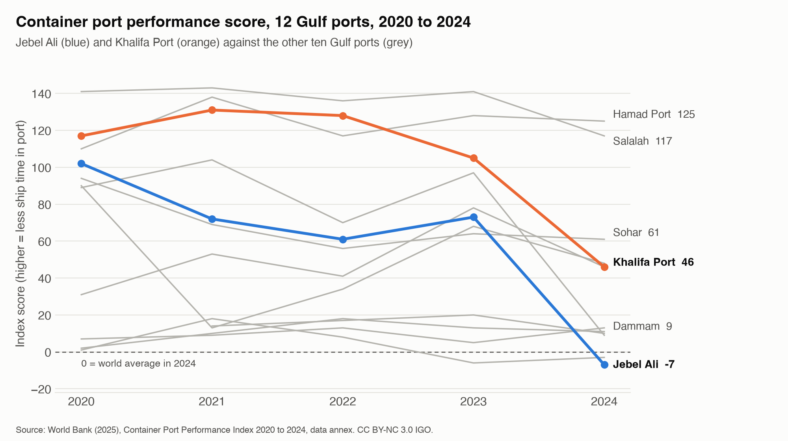
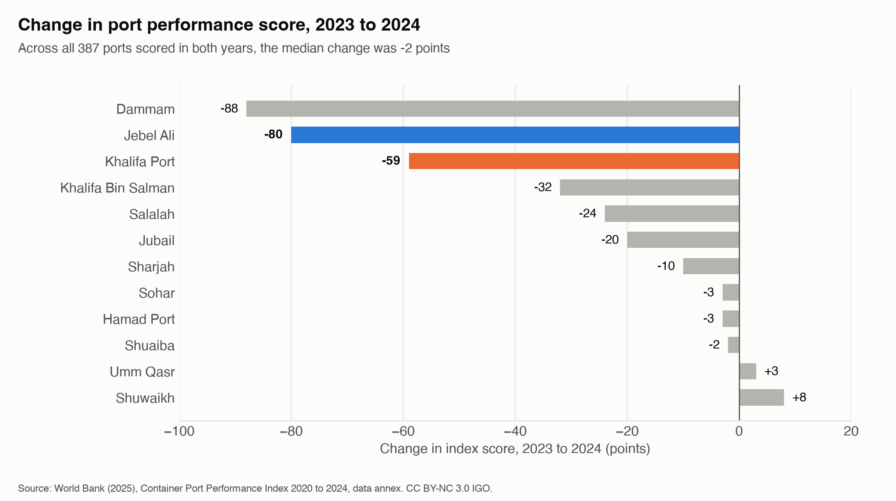
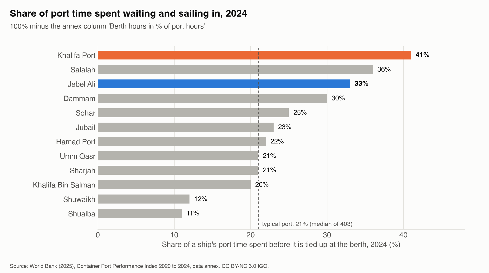

# UAE Ports Benchmark: where did ship time go in 2024?

**Question:** in 2024 Jebel Ali handled its highest container volume since 2015, yet its World Bank port-performance score fell further than almost any other Gulf port. Where did ship time go, and what should a terminal operator look at first?

**Answer:** both UAE container hubs lost more ground in 2024 than the Red Sea crisis alone explains, and at both an unusually large share of ship time passes before the ship reaches its berth. Before choosing between scheduling fixes and new capacity, a terminal operator should measure waiting-for-berth per ship call. The data shows where to look; it does not prove the cause.

**Read it in 2 minutes:** [5-slide deck (PDF)](outputs/deck/uae_ports_deck.pdf) · [one-page summary (PDF)](outputs/summary/one_page_summary.pdf)



## Data (real, public)

| Source | Used for |
|---|---|
| World Bank, 2025. *The Container Port Performance Index 2020 to 2024: Trends and Lessons Learned.* Washington DC. CC BY-NC 3.0 IGO. Data annex, 403 ports | Index score 2020-2024, 2024 rank, berth time as a share of port time (printed table: Jebel Ali p. 63, Khalifa Port p. 64) |
| DP World press release, 19 February 2025, "DP World records highest cargo volumes at Jebel Ali Port since 2015" | Jebel Ali 2024 volume (15.5 million TEU) and stated capacity (19.4 million TEU) |

The index measures how long container ships spend in port (arrival hours plus berth hours), compared with ships of the same size and the same number of container moves (report p. 49). **0 is the 2024 world average; higher means less time in port.** In this edition all five years are measured against the 2024 baseline, so scores can be compared across years (p. 53).

## Key numbers

All 12 ports of the World Bank's "Arabian Gulf" region: `data/processed/gulf_ports_cppi.csv`.

| Port | 2023 | 2024 | Rank 2024 (of 403) | Change |
|---|---|---|---|---|
| Jebel Ali (UAE) | 73 | -7 | 262 | -80 |
| Khalifa Port (UAE) | 105 | 46 | 68 | -59 |
| Sharjah (UAE) | 20 | 10 | 155 | -10 |
| Hamad Port (Qatar) | 128 | 125 | 11 | -3 |
| Salalah (Oman) | 141 | 117 | 15 | -24 |
| Dammam (Saudi Arabia) | 97 | 9 | 161 | -88 |

- Of the 387 ports scored in both years, 214 got worse; the median change was -2. Jebel Ali's fall of 80 points was larger than all but 21 of them.
- A third of a ship's port time at Jebel Ali, and two-fifths at Khalifa Port, is spent before the ship is tied up at the berth. The median port: about a fifth.
- Jebel Ali ran at about 80% of stated annual capacity in 2024 (15.5 / 19.4 million TEU; my calculation, DP World does not publish a utilisation rate).




## Recommendation

1. Collect per-call data for 2023 and 2024: hours at anchor, hours at berth and arrival against schedule, by week.
2. Test whether waiting rose in the weeks with the most volume or the most off-schedule arrivals.
3. If it did, start with scheduling: agreed berthing times shared with carriers, which Singapore used in 2024 while handling a record 40 million TEU and keeping a score of 88 (report p. 37), and berth windows (p. 35). Capacity comes second.

## Limits

- The index does not give causes (report p. 52). The fall coincides with record volume and with Red Sea diversions that made ship arrivals less predictable (p. xiv, p. 37); this project does not prove either caused it. Hamad Port held its score through the same year.
- "Time before berth" is a ratio. A port that works ships fast at the berth also shows a high share: Salalah has 36% and ranks 15th. It tells you where to look, not what is wrong.
- No hourly or per-call data; one index, one data provider (S&P Global via the World Bank).
- Khor Fakkan and Fujairah are not in the index. No Khalifa Port volume figure is used: I could not open a primary source for it.
- Several news sites reported Jebel Ali as 26th in this index; the World Bank's annex says 262nd. This project uses the annex.

## Run it

```bash
python3 -m venv .venv && source .venv/bin/activate
pip install -r requirements.txt
python src/extract_gulf.py && python src/charts.py
```

The deck and summary are HTML (`deck/`) printed to PDF with headless Chrome.

`data/raw/worldbank/` holds the annex as published. The report PDF is not redistributed here: https://openknowledge.worldbank.org/entities/publication/fa57ba78-0402-4eb4-b168-51708cf526f7

Author: Abderrahmane Messaoudi, Industrial Engineering & Engineering Management, University of Sharjah
